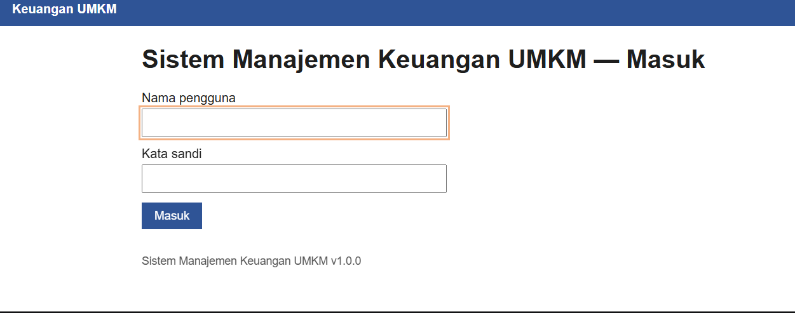
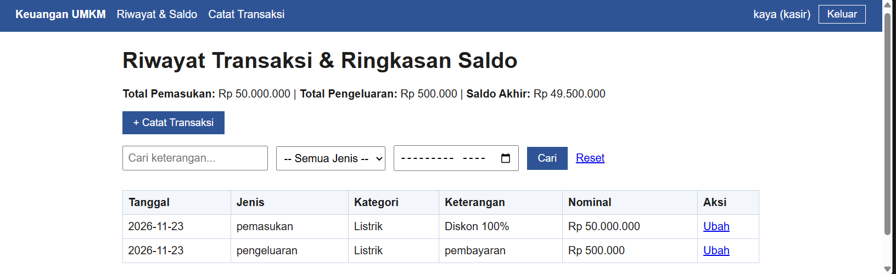
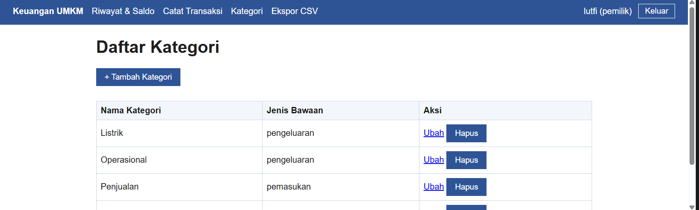
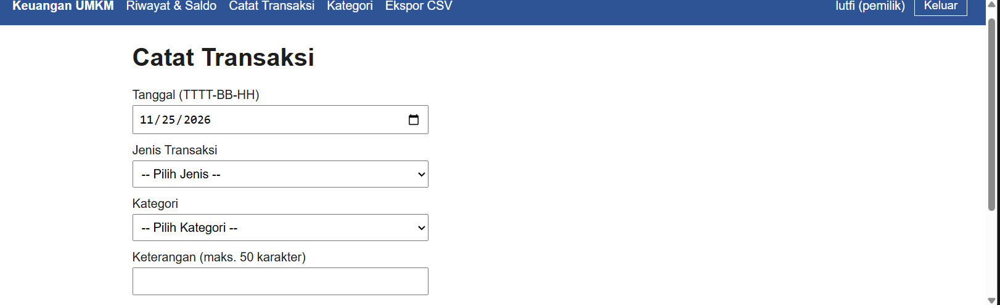
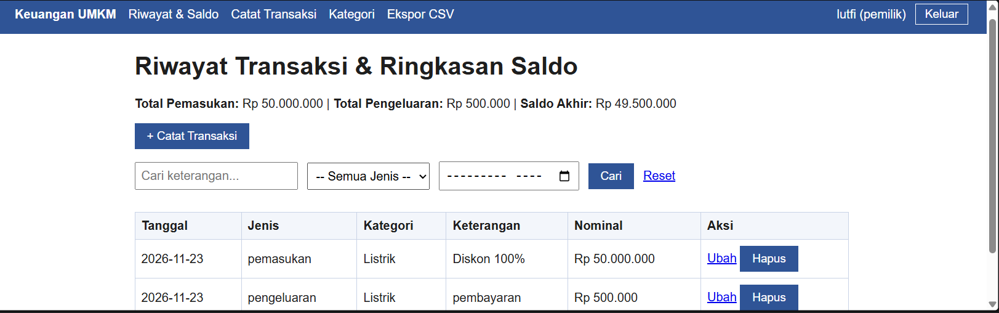

## 4.2 Implementasi Sistem

### 4.2.1 Struktur Proyek Tiga Lapis

Arsitektur aplikasi `rpl-manajemen-keuangan` diorganisasikan ke dalam pemisahan tanggung jawab tiga lapis (*three-tier architecture*) agar logika antarmuka, aturan validasi bisnis, dan kueri basis data tidak saling bercampur. Pemisahan ini memudahkan pengujian terisolasi pada setiap modul, memperjelas alur perbaikan cacat, serta mencegah kebocoran logika SQL langsung ke lapisan tampilan HTML.

```text
rpl-manajemen-keuangan/
├── app.py                 # Lapisan Kontrol: rute HTTP, sesi, CSRF, otorisasi peran
├── services.py            # Lapisan Layanan: validasi masukan, sanitasi, logika ringkasan
├── models.py              # Lapisan Data: koneksi SQLite, skema tabel, kueri berparameter
├── percobaan.py           # Keamanan: pembatas kegagalan login (5 kali / 5 menit)
├── buat_pengguna.py       # Utilitas CLI pembuatan akun pemilik dan kasir
├── cadangkan.py           # Utilitas CLI pencadangan basis data berstempel waktu
├── versi.py               # Penanda versi aplikasi (1.0.0)
├── templates/             # Lapisan Presentasi: templat HTML Jinja2
├── docs/                  # Dokumentasi: manual pengguna, gambar UI, UAT, dan Bab 4
└── tests/                 # Pengujian otomatis pytest dan uji regresi cepat
```

Pada lapisan presentasi, seluruh halaman mewarisi kerangka `templates/base.html` yang menampilkan bilah navigasi dinamis sesuai peran pengguna serta versi aplikasi `v1.0.0` pada kaki halaman. Pada lapisan layanan, `services.py` bertugas memvalidasi seluruh masukan sebelum menyentuh basis data, sementara `app.py` mengatur alur permintaan, verifikasi token CSRF, dan header keamanan HTTP. Seluruh akses baca-tulis ke berkas SQLite dipusatkan di dalam `models.py` menggunakan kueri berparameter (*parameterized queries*) untuk mencegah celah *SQL Injection*.

### 4.2.2 Implementasi Fitur Utama dan Cuplikan Kode Terpilih

Implementasi fitur mengacu langsung pada kebutuhan fungsional `KF-01` sampai dengan `KF-07` yang telah ditetapkan pada dokumen `PRD.md`:

1. **Autentikasi dan Pemisahan Hak Akses Dua Peran (`KF-01`, `KF-07`)**  
   Sistem menyediakan halaman masuk `/login` yang memverifikasi kecocokan nama pengguna dan kata sandi ter-hash (`werkzeug.security.check_password_hash`), dilengkapi pembatasan percobaan gagal pada `percobaan.py`. Setelah sesi terbentuk, dekorator `@wajib_pemilik` pada `app.py` membatasi rute sensitif seperti manajemen kategori, penghapusan transaksi, dan ekspor CSV agar hanya dapat diakses oleh peran `pemilik`, sedangkan peran `kasir` ditolak dengan respons `403 Forbidden` apabila mencoba mengakses URL tersebut secara langsung.

```python
def wajib_pemilik(fungsi):
    """Membatasi akses rute hanya untuk pengguna dengan peran pemilik."""
    @wraps(fungsi)
    def pembungkus(*args, **kwargs):
        if g.get("pengguna") is None:
            return redirect(url_for("masuk"))
        if g.pengguna["peran"] != "pemilik":
            app.logger.warning("akses ditolak user='%s' path='%s'", g.pengguna["username"], request.path)
            abort(403)
        return fungsi(*args, **kwargs)
    return pembungkus
```

   Cuplikan dekorator di atas menjadi titik kendali utama pemisahan kewenangan antarperan di sisi server sehingga keamanan tidak bergantung pada penyembunyian tombol di antarmuka semata. Perbedaan tampilan antara halaman masuk dan antarmuka terbatas peran `kasir` ditunjukkan pada tangkapan layar berikut.





2. **Manajemen Kategori Transaksi (`KF-02`)**  
   Fitur pengelolaan kategori pada rute `/kategori` memungkinkan peran `pemilik` menambah, mengubah, dan menghapus kategori dengan jenis bawaan `pemasukan`, `pengeluaran`, atau `umum`. Sebelum penghapusan dieksekusi di `models.py`, sistem memeriksa apakah identitas kategori masih dirujuk oleh baris pada tabel `transaksi`; jika masih terpakai, penghapusan ditolak dengan pesan peringatan agar integritas riwayat keuangan tetap terjaga.



3. **Pencatatan Transaksi Harian dan Ringkasan Saldo Otomatis (`KF-03`, `KF-04`)**  
   Setiap pencatatan pemasukan maupun pengeluaran melalui `/transaksi/tambah` divalidasi terlebih dahulu oleh fungsi pada `services.py`. Validasi ini memastikan format tanggal sesuai `YYYY-MM-DD`, panjang keterangan tidak melebihi batas ketentuan, serta nominal berupa bilangan bulat ASCII positif di antara 1 hingga 1.000.000.000. Setelah tersimpan, halaman `/transaksi` menghitung total pemasukan, total pengeluaran, dan saldo akhir secara otomatis.

```python
def validasi_nominal(teks_nominal):
    """Memastikan nominal berupa bilangan bulat ASCII positif 1..1.000.000.000."""
    bersih = str(teks_nominal or "").strip()
    if not bersih.isascii() or not bersih.isdigit():
        raise ValueError("Nominal harus berupa angka bulat positif tanpa titik atau koma.")
    nilai = int(bersih)
    if nilai < 1 or nilai > 1_000_000_000:
        raise ValueError("Nominal harus berupa angka lebih dari 0 (maksimal 1.000.000.000).")
    return nilai
```

   Penggunaan `bersih.isascii()` sebelum `bersih.isdigit()` pada cuplikan di atas dipilih untuk menutup celah lolosnya angka non-ASCII seperti digit Unicode yang secara bawaan dianggap benar oleh metode `.isdigit()` pada Python.





4. **Pencarian, Penyaringan Riwayat, dan Ekspor Laporan CSV (`KF-05`, `KF-06`)**  
   Pada halaman `/transaksi`, pengguna dapat mencari transaksi berdasarkan kata kunci keterangan serta menyaring daftar berdasarkan jenis transaksi dan bulan (`YYYY-MM`). Kata kunci pencarian diikat melalui *placeholder* SQLite dengan karakter *wildcard* yang di-escape agar input simbol seperti `%` atau `_` tidak memanipulasi hasil pencarian. Khusus peran `pemilik`, rute `/ekspor` membangkitkan berkas CSV langsung di memori agar mudah diunduh dan dibuka di Microsoft Excel.

### 4.2.3 Ringkasan Siklus Prompt Representatif

Selama pengembangan sistem, setiap interaksi dengan asisten AI dicatat dalam `jurnal/rangga.md` beserta keputusan peninjauannya. Tiga siklus berikut merangkum pola keputusan peninjauan yang berdampak langsung terhadap mutu kode dan dokumentasi aplikasi:

| Entri Jurnal | Tujuan Siklus | Keputusan | Temuan Peninjauan & Tindak Lanjut |
|---|---|---|---|
| Siklus 18 | Membangun fungsi kueri filter transaksi pada `models.py` (`KF-05`) | **Terima** | Kueri SQL berparameter dengan kondisi dinamis lulus seluruh kombinasi filter bulan dan jenis transaksi tanpa perubahan. |
| Siklus 34 | Menampilkan tombol aksi pada `templates/transaksi_list.html` (`KF-07`) | **Ubah** | Keluaran awal AI menampilkan tombol **Hapus** untuk semua pengguna; diubah dengan kondisi Jinja2 khusus peran `pemilik`. |
| Siklus 70 | Menyusun perintah konfigurasi produksi pada `README.md` | **Ubah** | Draf awal AI memakai variabel `TOKO_DB` dan sintaks CMD `set`; disesuaikan menjadi `KEUANGAN_DB` dan sintaks PowerShell `$env:`. |