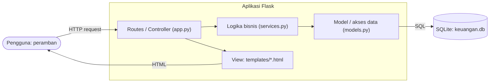

# Arsitektur Aplikasi dan Struktur Folder — Sistem Manajemen Keuangan UMKM

## 1. Diagram Arsitektur Berlapis (MVC)
Kode Mermaid berikut dapat dirender melalui `mermaid.live` (ekspor gambar opsional ke `docs/desain/arsitektur.png`):



## 2. Struktur folder proyek
```text
rpl-manajemen-keuangan/
├── app.py                  # routes / controller (menerima HTTP & memilih templat)
├── services.py             # logika bisnis (validasi nominal, hitung saldo, filter)
├── models.py               # satu-satunya berkas yang mengakses SQLite
├── templates/              # view (HTML Jinja2)
├── static/                 # berkas CSS dan aset gambar
├── tests/                  # cek_skema.py dan uji otomatis lainnya (Minggu 13)
├── docs/
│   ├── kesepakatan-tim.md
│   ├── product-backlog.md
│   ├── srs.md
│   ├── elisitasi/          # pedoman, catatan wawancara, user story
│   ├── uml/                # use case, skenario, activity diagram
│   └── desain/             # erd, normalisasi, kamus-data, schema.sql, arsitektur
├── PRD.md
├── aturan-proyek.md
└── jurnal-vibe-coding.md
```