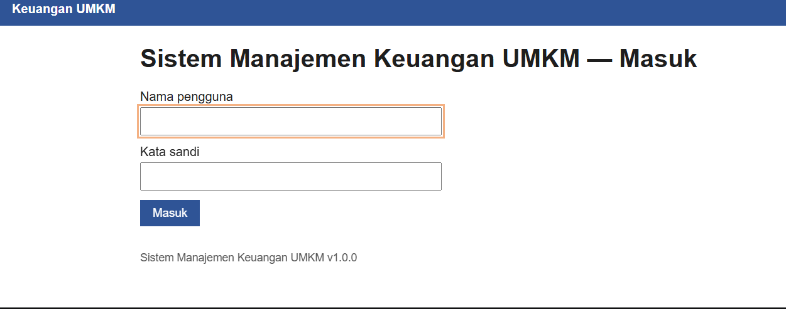
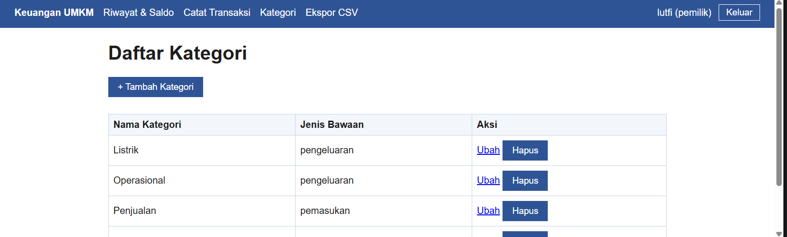
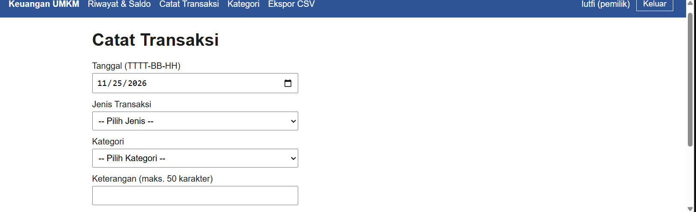
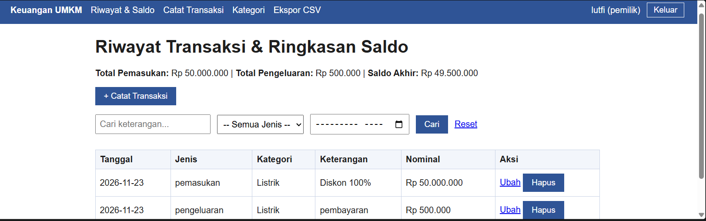
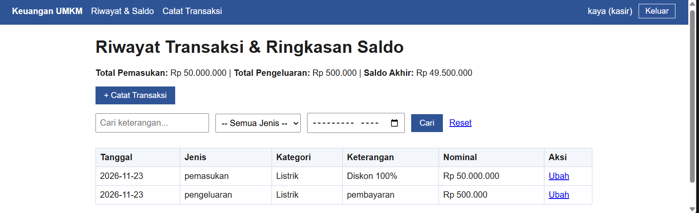

**Uji Orang Asing (Wajib dicatat di laporan):** Minta 1 rekan memasang aplikasi di folder baru (dengan `.venv` baru) **hanya dengan membaca `README.md`** sampai berhasil membuka halaman `/login`. Catat nama penguji, langkah yang sempat membingungkan (jika ada), dan perbaikan yang Anda lakukan pada `README.md`.

---

## Langkah 9. [Siklus 4] Manual Pengguna Bergambar (`docs/manual-pengguna.md`)

Jalankan aplikasi memakai data karangan, lalu ambil **minimal 5 tangkapan layar** yang sudah dipotong rapi dan simpan di folder `docs/gambar/` dengan nama berikut:
1. `01-halaman-masuk.png` (halaman `/login` beserta kaki halaman `v1.0.0`)
2. `02-riwayat-saldo.png` (halaman `/transaksi` akun `pemilik` dengan ringkasan saldo & daftar transaksi)
3. `03-catat-transaksi.png` (formulir `/transaksi/tambah`)
4. `04-kelola-kategori.png` (halaman `/kategori`)
5. `05-tampilan-kasir.png` (halaman `/transaksi` akun `kasir` — tanpa menu Kategori, Ekspor CSV, dan tombol Hapus)

Buat berkas **`docs/manual-pengguna.md`** dengan isi berikut:

```markdown
# Manual Pengguna — Sistem Manajemen Keuangan UMKM (v1.0.0)

Panduan ini disusun untuk pemilik usaha dan staf kasir dalam menjalankan pencatatan keuangan harian.

## 1. Masuk ke Aplikasi
1. Buka peramban (Chrome/Edge) dan ketik alamat aplikasi (misalnya `http://127.0.0.1:8000` atau alamat IP komputer utama).
2. Ketik **Nama pengguna** dan **Kata sandi** Anda.
3. Klik tombol **Masuk**.



*Catatan: Jika salah memasukkan sandi sebanyak 5 kali berturut-turut, akun akan dikunci sementara selama 5 menit untuk keamanan.*

## 2. Menyiapkan Kategori Pemasukan dan Pengeluaran (Khusus Pemilik)
1. Klik menu **Kategori** pada bilah atas.
2. Klik **+ Tambah Kategori**.
3. Isi **Nama Kategori** (maksimal 50 karakter, misalnya `Penjualan Harian` atau `Belanja Bahan`).
4. Pilih **Jenis Bawaan** (`pemasukan`, `pengeluaran`, atau `umum`), lalu klik **Simpan Kategori**.
5. Untuk mengubah atau menghapus kategori yang belum dipakai transaksi, klik **Ubah** atau **Hapus** di sebelah kanan baris kategori.



## 3. Mencatat Transaksi Harian dan Melihat Ringkasan Saldo
1. Klik menu **Catat Transaksi** (atau tombol **+ Catat Transaksi** pada halaman Riwayat).
2. Pilih **Tanggal**, **Jenis Transaksi** (`pemasukan` atau `pengeluaran`), dan **Kategori**.
3. Isi **Keterangan** singkat (maksimal 50 karakter) dan **Nominal** dalam Rupiah (angka bulat lebih dari 0, tanpa titik/koma).
4. Klik **Simpan**. Transaksi akan langsung muncul di daftar dan **Total Pemasukan**, **Total Pengeluaran**, serta **Saldo Akhir** diperbarui otomatis.



## 4. Mencari dan Menyaring Riwayat Transaksi
1. Buka menu **Riwayat & Saldo**.
2. Untuk mencari transaksi tertentu, ketik kata kunci pada kotak **Cari keterangan...**, pilih jenis transaksi, atau pilih bulan pada kotak filter.
3. Klik **Cari**. Untuk menampilkan kembali seluruh transaksi, klik **Reset**.



## 5. Mengunduh Rekap Laporan ke CSV / Excel (Khusus Pemilik)
1. Pada akun **Pemilik**, klik menu **Ekspor CSV** di bilah atas.
2. Berkas `rekap-keuangan-semua.csv` akan otomatis terunduh dan dapat dibuka langsung menggunakan Microsoft Excel.

## 6. Perbedaan Tampilan Pemilik dan Kasir
Staf **Kasir** dapat melihat riwayat, mencari transaksi, mencatat transaksi baru, dan mengubah transaksi. Menu **Kategori**, **Ekspor CSV**, serta tombol **Hapus** hanya muncul pada akun **Pemilik**.



## 7. Keluar dari Aplikasi
Selalu klik tombol **Keluar** di pojok kanan atas setelah selesai menggunakan aplikasi agar akun tidak dipakai orang lain.

## 8. Bila Ada Masalah

| Gejala / Pesan yang Muncul | Penyebab dan Cara Mengatasi |
|---|---|
| `Nama pengguna atau kata sandi salah.` | Periksa kembali ejaan huruf besar/kecil dan tombol Caps Lock, lalu coba lagi. Jika lupa sandi, minta pemilik membuatkan akun/sandi baru. |
| `Terlalu banyak percobaan gagal. Coba lagi beberapa menit lagi.` | Terjadi 5 kali kesalahan masuk berturut-turut. Tunggu 5 menit lalu masuk kembali dengan sandi yang benar. |
| `Akses Ditolak (403)` | Halaman atau aksi tersebut khusus untuk peran **Pemilik** dan tidak dapat diakses oleh **Kasir**. |
| `Nominal harus berupa angka lebih dari 0 (maksimal 1.000.000.000).` | Isi kolom nominal hanya dengan angka bulat positif tanpa tanda titik, koma, atau huruf. |
| `Kategori tidak dapat dihapus karena sudah dipakai pada transaksi.` | Kategori yang masih memiliki riwayat transaksi dilindungi agar laporan tidak rusak. Ubah namanya jika perlu, atau hapus transaksi terkait terlebih dahulu. |
| `Permintaan Tidak Valid (400)` | Sesi formulir kedaluwarsa. Muat ulang (refresh) halaman, lalu kirim ulang formulir. |
| Halaman aplikasi tidak bisa dibuka | Pastikan komputer utama menyala, server aplikasi aktif, dan perangkat terhubung ke jaringan lokal yang sama. |